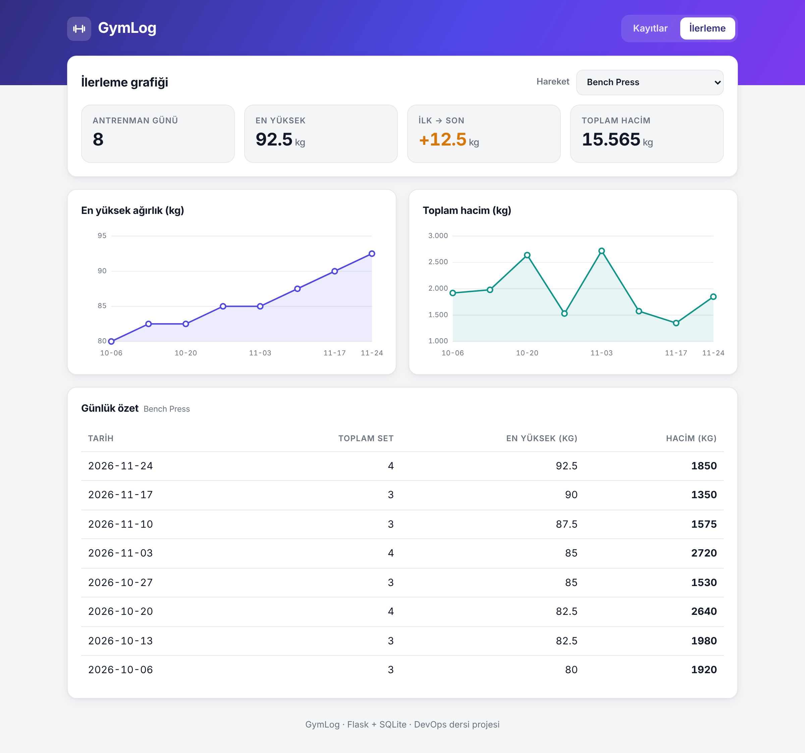

# GymLog: Antrenman Hacmi ve Gelişim Takipçisi

> Güncel Yazılım Geliştirme Süreçleri ve DevOps dersi, bireysel proje.
> Python, Flask ve SQLite ile geliştirilmiş bir web uygulaması.


## İçindekiler
1. [Problem ve hedef kullanıcı](#1-problem-ve-hedef-kullanıcı)
2. [Ödev maddeleri nerede?](#2-ödev-maddeleri-nerede)
3. [Pano (board)](#3-pano-board)
4. [Projeyi çalıştırma](#4-projeyi-çalıştırma)
5. [İki ana özelliği deneme](#5-iki-ana-özelliği-deneme)
6. [Ek özellikler](#6-ek-özellikler)
7. [Testler ve CI/CD](#7-testler-ve-cicd)
8. [Proje yapısı](#8-proje-yapısı)

## 1. Problem ve hedef kullanıcı
Düzenli spor salonuna giden kişiler hangi makinede ya da ekipmanla hangi hareketi kaç set,
kaç tekrar ve kaç kiloyla yaptıklarını genellikle not defterinde ya da dağınık telefon
notlarında tutar. Bu yüzden zaman içinde gerçekten ilerleyip ilerlemediklerini görmek zordur.

**GymLog**, salona düzenli giden **başlangıç ve orta seviye sporcular** için geliştirildi.
Antrenmanları tek bir yerde kaydetmelerini, her kaydın **antrenman hacmini** (set × tekrar × kg)
görmelerini, kişisel rekorlarını ve gelişimlerini takip etmelerini sağlar. Seri (streak) ve coin
sistemi de düzenli antrenman yapmayı teşvik eder.

## 2. Ödev maddeleri nerede?

| Ödevde istenen | Bu depoda |
|---|---|
| Hangi problemi çözdüğü ve kimin için geliştirildiği | [Bölüm 1](#1-problem-ve-hedef-kullanıcı) |
| “Yapılacak / Devam Ediyor / Tamamlandı” sütunlu pano | [GitHub Projects panosu](https://github.com/users/simpaicik/projects/1/views/1) |
| En az beş kart, her kartta açıklama ve kabul kriteri | Panoda [Issue #1–#7](https://github.com/simpaicik/DevOps/issues?q=is%3Aissue), metinlerin kopyası [`docs/BOARD.md`](docs/BOARD.md) (9 kart) |
| İki görevin geliştirilmesi | [Özellik 1 (#1)](#özellik-1-antrenman-kaydı-ekleme-ve-listeleme-1) ve [Özellik 2 (#2)](#özellik-2-antrenman-hacmi-hesaplama-2) |
| Kartlara commit / pull request bağlantısı | [Bölüm 3](#3-pano-board) tablosu ve Issue'lardaki bağlantılar |
| Projeyi çalıştırma adımları | [Bölüm 4](#4-projeyi-çalıştırma) |
| İki özelliğin nasıl deneneceği | [Bölüm 5](#5-iki-ana-özelliği-deneme) |

## 3. Pano (board)
- **Pano bağlantısı:** https://github.com/users/simpaicik/projects/1/views/1
- **Sütunlar:** Yapılacak, Devam Ediyor, Tamamlandı
- Her kart bir GitHub Issue'dur. Kısa açıklama ve kabul kriterleri Issue'nun içindedir.
  Metinlerin kopyası [`docs/BOARD.md`](docs/BOARD.md) dosyasındadır.
- Commit mesajlarında `#<issue-no>` geçtiği için ilgili commit ve pull request bağlantıları kartlarda kendiliğinden görünür.

| Kart | Durum | Commit / Pull request |
|------|-------|----------------|
| [#1](https://github.com/simpaicik/DevOps/issues/1) Antrenman kaydı ekleme ve listeleme | **Tamamlandı (Özellik 1)** | [3d2bb33](https://github.com/simpaicik/DevOps/commit/3d2bb33), [PR #8](https://github.com/simpaicik/DevOps/pull/8) |
| [#2](https://github.com/simpaicik/DevOps/issues/2) Antrenman hacmi hesaplama | **Tamamlandı (Özellik 2)** | [a0c26f3](https://github.com/simpaicik/DevOps/commit/a0c26f3), [PR #8](https://github.com/simpaicik/DevOps/pull/8) |
| [#5](https://github.com/simpaicik/DevOps/issues/5) Kişisel rekor (PR) tespiti | Tamamlandı (ek) | [1997f5d](https://github.com/simpaicik/DevOps/commit/1997f5d), [PR #9](https://github.com/simpaicik/DevOps/pull/9) |
| [#4](https://github.com/simpaicik/DevOps/issues/4) Hareket bazlı gelişim grafiği | Tamamlandı (ek) | [9dc9f38](https://github.com/simpaicik/DevOps/commit/9dc9f38), [PR #10](https://github.com/simpaicik/DevOps/pull/10) |
| [#6](https://github.com/simpaicik/DevOps/issues/6) Kayıt düzenleme ve silme | Tamamlandı (ek) | [9dc9f38](https://github.com/simpaicik/DevOps/commit/9dc9f38), [PR #10](https://github.com/simpaicik/DevOps/pull/10) |
| 8 Antrenman şablonları | Tamamlandı (ek) | [dfe56c7](https://github.com/simpaicik/DevOps/commit/dfe56c7), [PR #11](https://github.com/simpaicik/DevOps/pull/11) |
| 9 Seri (streak) ve coin sistemi | Tamamlandı (ek) | [PR #12](https://github.com/simpaicik/DevOps/pull/12) |
| [#7](https://github.com/simpaicik/DevOps/issues/7) Ekipman / hareket listesi yönetimi | Devam Ediyor | [75e6b58](https://github.com/simpaicik/DevOps/commit/75e6b58) (hazır hareket listesi), [PR #9](https://github.com/simpaicik/DevOps/pull/9) |
| [#3](https://github.com/simpaicik/DevOps/issues/3) Hareket ve tarihe göre filtreleme | Yapılacak | |

## 4. Projeyi çalıştırma
Uygulama açıldıktan sonra tarayıcıda **http://127.0.0.1:5000** adresine gidin.
Veritabanı (`instance/gymlog.db`) ilk açılışta kendiliğinden oluşur. Aşağıdaki üç yoldan biri yeterlidir.

### Yol 1: Windows'ta tek tıkla (en kolayı)
1. [Python 3.10 veya üstünü](https://www.python.org/downloads/) kurun. Kurulumda *Add python.exe to PATH* kutusunu işaretleyin.
2. Depoyu indirin: `git clone https://github.com/simpaicik/DevOps.git` ya da GitHub'da **Code → Download ZIP** ile indirip klasörü açın.
3. Klasördeki **`baslat.bat`** dosyasına çift tıklayın. Sanal ortamı kurar, bağımlılıkları yükler, uygulamayı başlatır ve tarayıcıyı açar.
4. Durdurmak için konsol penceresinde `Ctrl+C` yapın ya da pencereyi kapatın.

### Yol 2: Komut satırından
Windows PowerShell:
```powershell
git clone https://github.com/simpaicik/DevOps.git
cd DevOps
python -m venv .venv
.venv\Scripts\Activate.ps1          # "running scripts is disabled" hatası alırsanız önce:
                                    # Set-ExecutionPolicy -Scope Process -ExecutionPolicy Bypass
pip install -r requirements.txt
flask --app gymlog run              # http://127.0.0.1:5000
```

macOS / Linux:
```bash
git clone https://github.com/simpaicik/DevOps.git
cd DevOps
python3 -m venv .venv
source .venv/bin/activate
pip install -r requirements.txt
flask --app gymlog run
```

Veritabanını sıfırlamak için `instance/gymlog.db` dosyasını silin ya da `flask --app gymlog init-db` çalıştırın.

### Yol 3: Docker ile
Yalnızca [Docker Desktop](https://docs.docker.com/get-docker/) gerekir, Python kurmaya gerek yoktur.
```bash
git clone https://github.com/simpaicik/DevOps.git
cd DevOps
docker compose up --build           # http://127.0.0.1:5000
```
Durdurmak için `Ctrl+C` ya da `docker compose down`. Kayıtlar `gymlog-data` adlı Docker volume'ünde
tutulduğu için konteyner yeniden oluşturulsa da kaybolmaz.
İmaj `python:3.12-slim` tabanlıdır, uygulamayı `gunicorn` ile root olmayan bir kullanıcıyla çalıştırır
ve `/health` uç noktasını Docker `HEALTHCHECK` ile yoklar.

## 5. İki ana özelliği deneme
Ödev için seçilen iki görev #1 ve #2'dir. Her adımdaki **Beklenen** satırı, panodaki kartın kabul kriteridir.

### Özellik 1: Antrenman kaydı ekleme ve listeleme ([#1](https://github.com/simpaicik/DevOps/issues/1))
1. Uygulamayı çalıştırıp http://127.0.0.1:5000 adresini açın.
2. **Yeni antrenman kaydı** formunu doldurun: Hareket `Bench Press`, Ekipman `Barbell`, Set `3`, Tekrar `10`, Ağırlık `50`. **Kaydet**'e basın.
   - **Beklenen:** "Bench Press kaydı eklendi." mesajı çıkar ve kayıt **Kayıtlar** tablosunda görünür.
3. Sayfayı yenileyin ya da uygulamayı kapatıp yeniden başlatın.
   - **Beklenen:** Kayıt yerinde durur, çünkü SQLite'a kaydedilmiştir.
4. Set alanına `0`, Ağırlık alanına `-5` yazıp gönderin.
   - **Beklenen:** Kayıt eklenmez, "Set en az 1 olmalı." ve "Ağırlık en az 0 olmalı." hata mesajları görünür.

### Özellik 2: Antrenman hacmi hesaplama ([#2](https://github.com/simpaicik/DevOps/issues/2))
1. Özellik 1'de eklenen kaydın **Hacim (kg)** sütununa bakın.
   - **Beklenen:** `1500` (3 × 10 × 50).
2. Aynı tarihe `Barbell Row`, 2 set × 10 tekrar × 50 kg bir kayıt daha ekleyin (hacim 1000).
   - **Beklenen:** **Günlük toplam hacim** tablosunda o gün için `2500` görünür.
3. **Hareket bazında toplam hacim** tablosuna bakın.
   - **Beklenen:** Her hareketin toplamı büyükten küçüğe listelenir. Üstteki **Toplam hacim** kartı tüm kayıtların toplamını gösterir.

## 6. Ek özellikler
İki ana görevden sonra panodaki diğer kartlar da geliştirildi. Hepsi otomatik testlerle doğrulanır.

### Kişisel rekor (PR) tespiti ([#5](https://github.com/simpaicik/DevOps/issues/5))
1. `Bench Press` için `2026-11-01` tarihli 80 kg, ardından `2026-11-08` tarihli 85 kg'lık kayıt ekleyin.
   - **Beklenen:** "Yeni kişisel rekor!" mesajı çıkar, 85 kg'lık kayıt turuncu **PR** rozetiyle işaretlenir.
2. Daha yeni bir tarihte 80 kg girin.
   - **Beklenen:** Bu kayıt PR sayılmaz. Eşit ya da daha düşük ağırlık rekor değildir.

### Kayıt düzenleme ve silme ([#6](https://github.com/simpaicik/DevOps/issues/6))
1. Bir kaydın satırındaki çöp kutusu simgesine basıp onaylayın.
   - **Beklenen:** Kayıt listeden ve günlük toplam hacimden düşer.
2. Bir kaydın kalem simgesine basın, Set `4`, Tekrar `8`, Ağırlık `60` yapıp kaydedin.
   - **Beklenen:** Satırın hacmi `1920` olur, günlük toplam da güncellenir.

### Hareket bazlı gelişim grafiği ([#4](https://github.com/simpaicik/DevOps/issues/4))


1. `Bench Press` için üç farklı tarihte kayıt ekleyin, üst menüden **İlerleme** sayfasını açıp `Bench Press`'i seçin.
   - **Beklenen:** **En yüksek ağırlık** ve **Toplam hacim** grafiklerinde 3 nokta görünür.
2. `http://127.0.0.1:5000/progress?exercise=Deadlift` adresini açın (kaydı olmayan hareket).
   - **Beklenen:** "Veri yok." mesajı gösterilir.

### Hazır hareket listesi ([#7](https://github.com/simpaicik/DevOps/issues/7), kısmen)
1. Formdaki **Hareket** kutusuna tıklayıp `curl` yazın.
   - **Beklenen:** Kas grubuna göre etiketlenmiş ~200 hazır hareketten curl çeşitleri önerilir.
2. Listede olmayan bir hareket yazıp kaydedin.
   - **Beklenen:** Sonraki kayıtlarda bu hareket "Kendi hareketin" etiketiyle önerilir.

### Antrenman şablonları (kart 8)
1. **Şablonlar** sayfasında `Push günü` adıyla `Bench Press` 3 × 8 × 60 ve `Overhead Press` 3 × 10 × 40 satırlarını kaydedin.
   - **Beklenen:** Şablon hareketleriyle birlikte listelenir.
2. **Bugüne yükle**'ye basın (ana sayfadaki **Şablondan başla** kartı da aynı işi yapar).
   - **Beklenen:** Bugünün tarihiyle 2 kayıt eklenir.
3. Set, tekrar ya da ağırlığı boş bir şablonu yüklemeyi deneyin.
   - **Beklenen:** Kayıt eklenmeden önce eksik değerleri doldurma sayfası açılır.

### Seri (streak) ve coin sistemi (kart 9)
Antrenman kaydı olan ardışık günler **seri** oluşturur. Antrenman yapılan her gün bir kez **coin**
kazanılır ve ödül seri uzadıkça haftadan haftaya artar: 1–7. gün 10 coin, 8–14. gün 15 coin,
15–21. gün 20 coin, en fazla 50 coin.

1. Bugünün tarihiyle bir kayıt ekleyin.
   - **Beklenen:** "+10 coin! 1 günlük seri" mesajı çıkar. Ana sayfadaki seri kartında seri 1 gün, bakiye 10 coin olur.
2. Bugüne ikinci bir kayıt ekleyin.
   - **Beklenen:** Yeni coin verilmez, çünkü günlük ödül günde bir kez verilir.
3. Geçmiş bir tarihe kayıt ekleyin.
   - **Beklenen:** Kayıt seriye sayılır ama coin kazandırmaz.

Bugün henüz kayıt yoksa dünkü seri gün sonuna kadar korunur, bir gün boş geçerse seri sıfırlanır.
Bakiye `coin_transactions` tablosunda hareket geçmişiyle saklanır. İleride eklenecek market (ör. profil
çerçevesi) harcamaları buraya eksi tutarlı satırlar olarak yazılacak.

## 7. Testler ve CI/CD
```bash
pip install pytest
pytest -v
```
Her kartın kabul kriterleri otomatik testlerle de doğrulanır:

| Test dosyası | Kart |
|---|---|
| `tests/test_workouts.py` | #1 Antrenman kaydı |
| `tests/test_volume.py` | #2 Hacim hesaplama |
| `tests/test_records.py` | #5 Kişisel rekor |
| `tests/test_progress.py` | #4 Gelişim grafiği |
| `tests/test_edit_delete.py` | #6 Düzenleme ve silme |
| `tests/test_exercises.py` | #7 Hareket listesi |
| `tests/test_templates.py` | 8 Antrenman şablonları |
| `tests/test_streaks.py` | 9 Seri ve coin |

Her push ve pull request'te GitHub Actions ([`.github/workflows/ci.yml`](.github/workflows/ci.yml)) iki iş çalıştırır:
1. **test:** Bağımlılıkları kurar ve `pytest` ile tüm testleri çalıştırır.
2. **docker:** Testler geçerse Docker imajını derler, konteyneri başlatır ve `/health` uç noktasının yanıt verdiğini doğrular.

Geliştirme akışı: her iş ayrı bir dalda yapılır, pull request ile açılır, CI yeşil olduktan sonra `main`'e birleştirilir.

## 8. Proje yapısı
```
gymlog/                 Flask uygulaması
  routes.py             sayfalar ve form işlemleri
  schema.sql            SQLite tabloları
  volume.py             hacim hesapları (#2)
  records.py            kişisel rekor tespiti (#5)
  progress.py           gelişim grafiği (#4)
  workout_templates.py  antrenman şablonları
  streaks.py, coins.py  seri ve coin sistemi
  templates/, static/   HTML şablonları ve CSS
tests/                  pytest testleri
docs/BOARD.md           pano kartlarının metinleri
Dockerfile              üretim imajı (gunicorn)
compose.yaml            Docker Compose ile tek komutla çalıştırma
baslat.bat              Windows için tek tıkla çalıştırma
.github/workflows/      CI (test + Docker)
```
