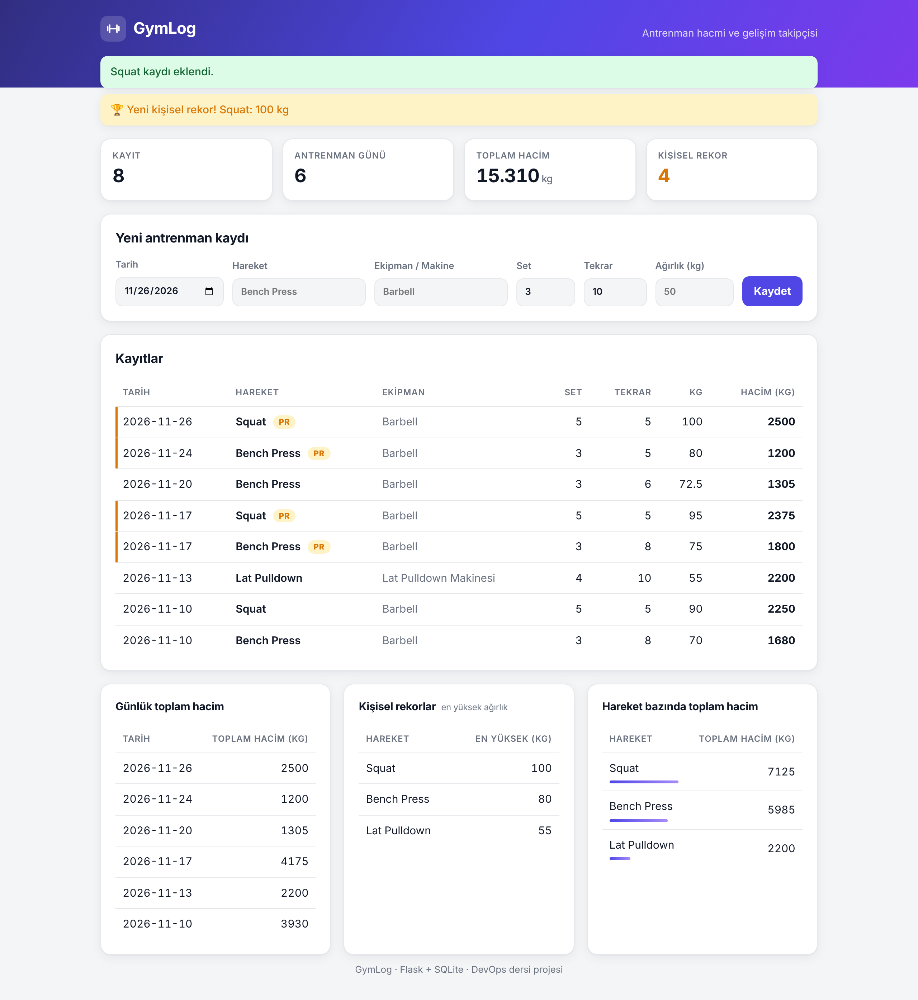

# GymLog: Antrenman Hacmi ve Gelişim Takipçisi

> Güncel Yazılım Geliştirme Süreçleri ve DevOps dersi, bireysel proje.



## Problem ve hedef kullanıcı
Düzenli spor salonuna giden kişiler hangi makinede ya da ekipmanla hangi hareketi kaç set,
kaç tekrar ve kaç kiloyla yaptıklarını genellikle not defterinde ya da dağınık telefon
notlarında tutar. Bu yüzden zaman içinde gerçekten ilerleyip ilerlemediklerini görmek zordur.

**GymLog**, başlangıç ve orta seviye sporcular için geliştirilmiş basit bir web uygulamasıdır.
Antrenmanları tek bir yerde kaydetmelerini, her kaydın **antrenman hacmini** (set × tekrar × kg)
görmelerini ve kişisel rekorlarıyla gelişimlerini takip etmelerini sağlar.

## Pano (board)
- **GitHub Projects panosu:** https://github.com/users/simpaicik/projects/1/views/1
- Sütunlar: **Yapılacak**, **Devam Ediyor**, **Tamamlandı**
- Her kart bir GitHub Issue'dur; açıklama ve kabul kriterleri Issue içindedir (metinlerin kopyası: [`docs/BOARD.md`](docs/BOARD.md)).
  Commit mesajlarında `#<issue-no>` geçtiği için ilgili commit ve pull request bağlantıları kartlarda otomatik görünür.

| # | Kart | Durum |
|---|------|-------|
| [#1](https://github.com/simpaicik/DevOps/issues/1) | Antrenman kaydı ekleme ve listeleme | Tamamlandı (Özellik 1) |
| [#2](https://github.com/simpaicik/DevOps/issues/2) | Antrenman hacmi hesaplama | Tamamlandı (Özellik 2) |
| [#5](https://github.com/simpaicik/DevOps/issues/5) | Kişisel rekor (PR) tespiti | Tamamlandı (ek özellik) |
| [#7](https://github.com/simpaicik/DevOps/issues/7) | Ekipman / hareket listesi yönetimi | Devam Ediyor (hazır hareket listesi eklendi) |
| [#3](https://github.com/simpaicik/DevOps/issues/3) | Hareket ve tarihe göre filtreleme | Yapılacak |
| [#4](https://github.com/simpaicik/DevOps/issues/4) | Hareket bazlı gelişim grafiği | Yapılacak |
| [#6](https://github.com/simpaicik/DevOps/issues/6) | Kayıt düzenleme ve silme | Yapılacak |

## Teknolojiler
Python 3.10+, Flask, SQLite, pytest, Docker (gunicorn), GitHub Actions (CI)

## Projeyi çalıştırma
Uygulama açıldıktan sonra tarayıcıda **http://127.0.0.1:5000** adresine gidin.
Veritabanı (`instance/gymlog.db`) ilk çalıştırmada otomatik oluşturulur. Üç yoldan biri yeterlidir.

### Yol 1: Windows'ta tek tıkla
1. [Python 3.10 veya üstü](https://www.python.org/downloads/) kurulu olsun (kurulumda *Add python.exe to PATH* kutusunu işaretleyin).
2. Depoyu indirin: `git clone https://github.com/simpaicik/DevOps.git` ya da GitHub'da **Code → Download ZIP** ile indirip klasörü açın.
3. Klasördeki **`baslat.bat`** dosyasına çift tıklayın. Sanal ortamı kurar, bağımlılıkları yükler, uygulamayı başlatır ve tarayıcıyı açar.
4. Durdurmak için açılan konsol penceresinde `Ctrl+C` yapın ya da pencereyi kapatın.

### Yol 2: Komut satırından (Windows PowerShell)
```powershell
git clone https://github.com/simpaicik/DevOps.git
cd DevOps
python -m venv .venv
.venv\Scripts\Activate.ps1          # "running scripts is disabled" hatası alırsanız önce:
                                    # Set-ExecutionPolicy -Scope Process -ExecutionPolicy Bypass
pip install -r requirements.txt
flask --app gymlog run              # http://127.0.0.1:5000
```

macOS / Linux için aynı adımlar, yalnızca etkinleştirme satırı farklıdır:
```bash
python3 -m venv .venv
source .venv/bin/activate
pip install -r requirements.txt
flask --app gymlog run
```

Veritabanını sıfırlamak için `instance/gymlog.db` dosyasını silin ya da `flask --app gymlog init-db` çalıştırın.

### Yol 3: Docker ile
Yalnızca [Docker Desktop](https://docs.docker.com/get-docker/) kurulu olması yeterlidir, Python gerekmez.
```bash
git clone https://github.com/simpaicik/DevOps.git
cd DevOps
docker compose up --build           # http://127.0.0.1:5000
```
Durdurmak için `Ctrl+C` ya da `docker compose down`. Kayıtlar `gymlog-data` adlı Docker volume'ünde
tutulur, konteyner yeniden oluşturulsa da kaybolmaz (`docker compose down -v` volume'ü de siler).

Compose kullanmadan:
```bash
docker build -t gymlog .
docker run -d --name gymlog -p 5000:5000 -v gymlog-data:/app/instance gymlog
docker ps                           # STATUS sütununda bir süre sonra "(healthy)" görünür
```
İmaj `python:3.12-slim` tabanlıdır, uygulamayı `gunicorn` ile root olmayan bir kullanıcıyla çalıştırır
ve `/health` uç noktasını Docker `HEALTHCHECK` ile yoklar.

## Özellikleri deneme
Her adımın sonunda beklenen sonuç, panodaki kartın kabul kriteridir.

### Özellik 1: Antrenman kaydı ekleme ve listeleme ([#1](https://github.com/simpaicik/DevOps/issues/1))
1. Uygulamayı çalıştırıp http://127.0.0.1:5000 adresini açın.
2. **Yeni antrenman kaydı** formunu doldurun: Hareket `Bench Press`, Ekipman `Barbell`, Set `3`, Tekrar `10`, Ağırlık `50`. **Kaydet**'e basın.
   - **Beklenen:** "Bench Press kaydı eklendi." mesajı çıkar ve kayıt **Kayıtlar** tablosunda görünür.
3. Sayfayı yenileyin ya da uygulamayı kapatıp yeniden başlatın.
   - **Beklenen:** Kayıt yerinde durur (SQLite'a kaydedildi).
4. Set alanına `0`, Ağırlık alanına `-5` yazıp gönderin.
   - **Beklenen:** Kayıt eklenmez, "Set en az 1 olmalı." ve "Ağırlık en az 0 olmalı." hata mesajları görünür.

### Özellik 2: Antrenman hacmi hesaplama ([#2](https://github.com/simpaicik/DevOps/issues/2))
1. Özellik 1'de eklenen kaydın **Hacim (kg)** sütununa bakın.
   - **Beklenen:** `1500` (3 × 10 × 50).
2. Aynı tarihe `Barbell Row`, 2 set × 10 tekrar × 50 kg bir kayıt daha ekleyin (hacim 1000).
   - **Beklenen:** **Günlük toplam hacim** tablosunda o gün için `2500` görünür.
3. **Hareket bazında toplam hacim** tablosu her hareketin toplamını büyükten küçüğe listeler. Üstteki **Toplam hacim** kartı da tüm kayıtların toplamını gösterir.

### Ek özellik: Kişisel rekor (PR) tespiti ([#5](https://github.com/simpaicik/DevOps/issues/5))
1. `Bench Press` için `2026-11-01` tarihli, 80 kg'lık bir kayıt ekleyin.
2. Aynı hareket için daha yeni bir tarihte (ör. `2026-11-08`) 85 kg'lık kayıt ekleyin.
   - **Beklenen:** "Yeni kişisel rekor!" mesajı çıkar, kayıt tabloda turuncu **PR** rozetiyle işaretlenir.
3. Daha yeni bir tarihte 80 kg (ya da 85 kg) girin.
   - **Beklenen:** Bu kayıt PR sayılmaz, rozet görünmez.
4. **Kişisel rekorlar** tablosunda her hareketin en yüksek ağırlığı listelenir.

Kurallar: hareketin ilk kaydı karşılaştırılacak önceki değer olmadığından PR sayılmaz, eşit ağırlık rekor değildir,
kayıtlar giriş sırasına değil tarihe göre değerlendirilir.

### Ek özellik: Hazır hareket listesi ([#7](https://github.com/simpaicik/DevOps/issues/7), kısmen)
1. Formdaki **Hareket** kutusuna tıklayın.
   - **Beklenen:** Kas grubuna göre etiketlenmiş ~200 hazır hareket önerilir (Göğüs, Sırt, Bacak, ...).
2. `curl` yazın.
   - **Beklenen:** Liste yalnızca curl çeşitlerine süzülür.
3. Listede olmayan bir hareket (ör. `Salonumdaki Özel Makine`) yazıp kaydedin, sonra kutuya tekrar tıklayın.
   - **Beklenen:** Yeni hareket listenin başında "Kendi hareketin" etiketiyle önerilir.

## Testler ve CI
```bash
pytest -v
```
Her özelliğin kabul kriterleri otomatik testlerle de doğrulanır: `tests/test_workouts.py` (#1),
`tests/test_volume.py` (#2), `tests/test_records.py` (#5), `tests/test_exercises.py` (#7).

Her push'ta ve pull request'te GitHub Actions (`.github/workflows/ci.yml`) iki iş çalıştırır:
1. **test**: bağımlılıkları kurar ve `pytest` ile tüm testleri çalıştırır.
2. **docker**: testler geçerse Docker imajını derler, konteyneri başlatır ve `/health` uç noktasının yanıt verdiğini doğrular.

## Proje yapısı
```
gymlog/            Flask uygulaması (routes, veritabanı, hacim ve rekor hesapları, şablonlar, CSS)
tests/             pytest testleri
docs/BOARD.md      Pano kartlarının metinleri
Dockerfile         Üretim imajı (gunicorn)
compose.yaml       Docker Compose ile tek komutla çalıştırma
baslat.bat         Windows için tek tıkla çalıştırma
.github/workflows  CI (test + Docker)
```
